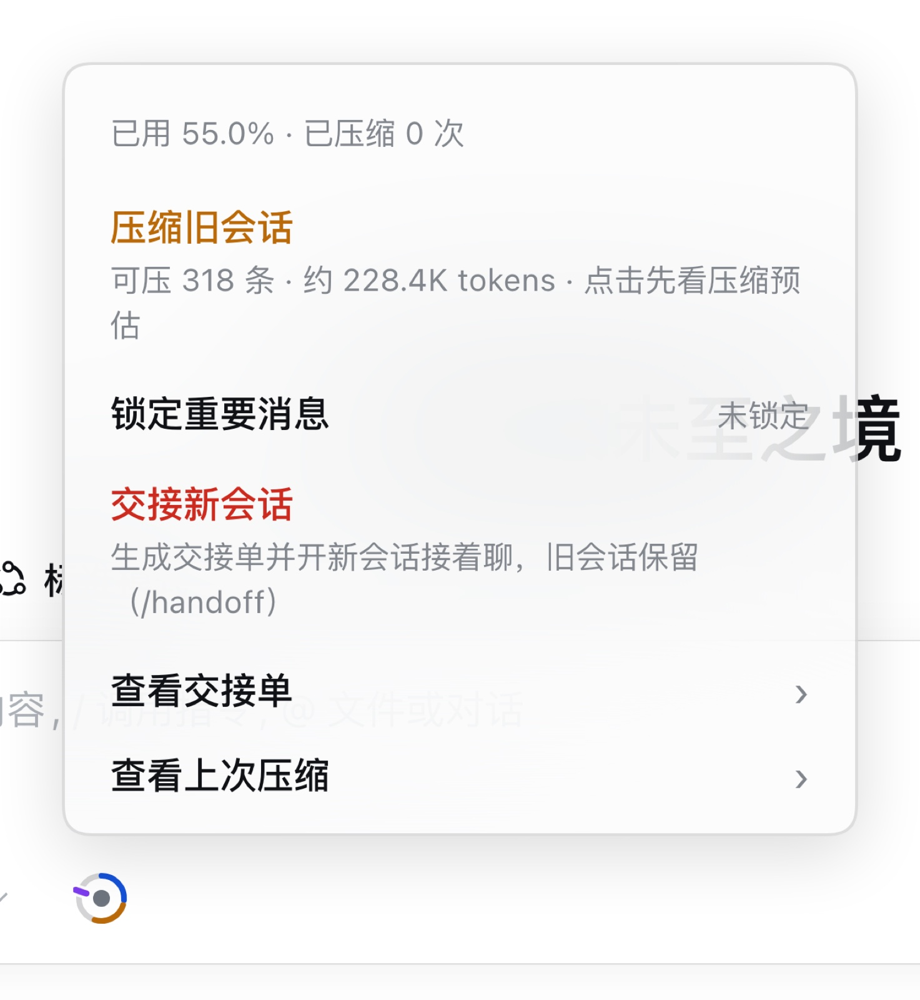

<div align="center">

# dsh-compact-relay

**Context window indicator and session management plugin for the DeepSeek Harness composer.**

[简体中文](README.md) · English

[](https://www.npmjs.com/package/dsh-compact-relay)
[](https://www.deepseek.com/harness/)
[](LICENSE)
[](CHANGELOG.md)

</div>


## Overview

This plugin adds a 28px ring indicator beside the composer. It reports context occupancy and compression-assessment state in real time so that context can be managed before automatic compaction is triggered:

- **Gray**: below the minimum compression threshold; compaction is not required.
- **Blue**: the normal capacity zone is full; manual compaction is available to free space.
- **Amber (with notch)**: the suggested compression point has been reached (identified by the notch); click to preview the compression estimate and decide whether to run it.
- **Red**: the handoff threshold has been reached; generating a nine-section handoff document and switching to a new session is recommended.

The plugin mounts beside the existing composer. Default parameters are tuned for DSH 0.2.x; no change to the existing workflow is required.

## Core capabilities

### 1. Occupancy visualization

The ring is colored in segments according to the compression-assessment logic: the suggested compression point determined by the model or configured threshold, the positions of pinned messages, and the DSH native auto-compaction line (the actual trigger point computed from the host token budget: ~67.8% for deepseek-flash, while the configured threshold defaults to 80%). When occupancy crosses the actual trigger point, the ring flashes red.

When occupancy enters the compressible band (between the minimum compression line and the compression line), the plugin proactively tells the model the current occupancy and band through a dynamic system-prompt context, so it can decide whether to record a compression node after finishing a natural milestone (since 0.3.4; before that the model could not see occupancy, so the condition was not actionable).

Hovering over the ring displays exact values: capacity used, cumulative compaction count, current suggestion, compression point, native auto-compaction line, and the number of pinned messages.

### 2. Preview-then-confirm compaction

Running `/bc` (or using the ring menu) previews the range to be compacted, the message count, and the estimated capacity to be freed. Execution requires explicit confirmation. The operation can be cancelled before confirmation, and no history is modified until it is committed; pinned messages are skipped automatically.


### 3. Structured session handoff

Running `/handoff` generates a handoff document with nine standard sections (overall goal, constraints, completed items, current progress, files involved, key decisions, known issues, open items, next steps), creates a new session in the current workspace, injects the document, and switches to it. The original session is retained intact.

### 4. Message pinning

Running `/pin` marks messages that must be preserved during compaction. Pinned messages appear as magenta blocks on the ring and as locked rows in the menu.



## Ring legend

| Ring element | Meaning |
| --- | --- |
| Gray arc | Below the minimum compression threshold; compaction not recommended |
| Blue arc | The normal capacity zone is full |
| Amber arc | The compression point has been passed; compaction is suitable |
| Red arc | The handoff threshold has been passed; switching to a new session is recommended |
| Ring notch | Suggested compression point (the system proactively prompts the model to assess inside the compressible band; shown after the model records one or the compression line is reached) |
| Violet tick | DSH native auto-compaction line: the actual trigger point computed as `min(window × thresholdRatio, window − reserved output − headroomTokens)` (~67.8% for deepseek-flash; the configured `thresholdRatio` defaults to 80% and is only a theoretical ceiling) |
| Magenta blocks | Distribution of pinned messages in the history |
| Full-ring red flash | The native auto-compaction line has been crossed; DSH native auto-compaction is imminent |


## Installation

**Requirements**: DSH Desktop or `dsh web` 0.2.x (tested on 0.2.1-rc.2), Node.js 22+ (the plugin uses the runtime bundled with DSH). Running the source test suite requires Node **22.15+** (the harness uses `node:module.registerHooks`). The suite is verified on macOS and Windows 11 (Node 24.22).

```sh
dsh plugin --profile desktop add dsh-compact-relay
```

In the desktop app, the plugin can also be installed from **Plugins → Add plugin** by package name, or directly from GitHub:

```sh
dsh plugin --profile desktop add github:cfanzx/dsh-compact-relay
```

Restart DSH after installation. Configuration changes saved inside the plugin take effect immediately and do not require a restart.

## Settings

Configuration is available under **Settings → 压缩接力** (in the account menu on DSH 0.2.1+):

- **Compaction hints**: configure the minimum compression line, compression line, and handoff line to control when warnings are emitted.
- **Compaction behaviour**: configure the summary retention limit, the recent-token retention count, and the handoff document directory.
- **DSH native auto-compaction**: read the host's current threshold and enable or disable DSH native auto-compaction (a backup is created before the profile configuration is modified; a restart is required for the change to take effect).
- **Colors & appearance**: configure five base colors; the system derives adapted shades for the light and dark themes automatically.
- **Help**: ring legend, usage notes, feedback links, a "show the onboarding again" button, and **Diagnostics** (generated locally, preview-then-copy — see the next section).
- **About / dangerous operations**: version number, configuration file path, and factory reset.


Each setting includes a definition and a description of the effect of changing it. The help section contains five dynamic example rings that update in real time with the current colors and thresholds.


The first time a session is opened, the ring plays a brief highlight animation with a short functional description (triggered automatically once only; it can be replayed from the Settings page).


## Diagnostics and privacy

**Settings → 压缩接力 → Help → Diagnostics**:

- **Generate and preview**: creates a Markdown + JSON diagnostics report **locally**, shows it in a preview dialog first; then **Copy Markdown** / **Copy JSON** and paste it wherever you choose (for example a GitHub issue).
- **Open issue page**: opens a GitHub issue page with the short version/platform fields pre-filled. It does **not** paste the diagnostics report for you — you decide whether and where to paste it.

**What the report contains**: plugin version, DSH version (empty when unavailable), Node / OS / architecture / locale; configured thresholds, retention, timeouts and color mode; a numeric snapshot of the current state (window, used tokens, summaries, pinned count); per-load counts for compaction/handoff/pinning, p50/p95 durations, and the last 20 error codes.

**What it never contains**: chat content, summaries, handoff document bodies, tool arguments/results, file paths, usernames, hostname, session ids, keys/tokens/cookies, other plugin lists or custom links. The report is built field-by-field from an allowlist inside the host process, then run through a second regex redaction pass (matches are replaced with `[REDACTED]` and only the count is recorded — never the original text).

**Three privacy notes**:

1. The report is **generated locally only**: the plugin has no automatic upload, telemetry or outbound network requests, and the diagnostics endpoint is a read-only GET with no upload channel.
2. **No conversation content is touched**: only numbers, enums, booleans and error codes are collected; messages, summaries and handoff bodies are never read.
3. Opening the issue page only opens a browser. Issues are public by default; whether and where you paste is up to you. The plugin adds no network capability and reports nothing.

## Commands

| Command | Description |
| --- | --- |
| `/bc` | Preview compaction: target range, message count, and estimated capacity to be freed |
| `/bc confirm` | Execute the previewed compaction |
| `/handoff` | Generate a nine-section handoff document, then create and switch to a new session |
| `/pin` / `/unpin` | Pin or unpin a message; pinned messages are skipped during compaction |
| `/bctest` | Small dry-run test (development debugging only) |

## Scope and limitations

- **Does not replace DSH native compaction**: native compaction remains under DSH host control; this plugin only reads the threshold, displays warnings, and provides a toggle in Settings.
- **Does not modify prompts or model replies**: history is replaced only when the user explicitly confirms a compaction or runs a handoff.
- **Summary quality depends on the underlying model**: summaries use a structured nine-section template with format validation and a single retry, but output quality remains limited by the selected model.
- **Local storage only**: plugin state is stored in `~/.dsh/compact-relay.json` and handoff documents in `~/.dsh/handoffs/`; no external data is synchronized.
- **Tied to the desktop composer**: the ring indicator, `/bc` and `/handoff` depend on the DSH composer and slash-command system. They are not loaded in headless sessions or in bridge links such as QQ/WeChat, where `/bc` is treated as an ordinary message. That is a limitation of the bridge link, not a plugin failure.
- **UI language limitation**: the current UI is Simplified Chinese only; an English UI is planned with no fixed schedule.
- **Prerequisite for the model hint**: the compressible-band hint relies on the DSH 0.2.x root service `systemPrompt` (same as plugins such as memory). It is a heuristic prompt and does not guarantee the model records a compression node every time, but the condition is now actionable instead of unobservable.

## Version and license

- **Current version**: 0.4.1 (0.3.1 was the first public release; 0.3.2 fixed settings links and contact details; 0.3.3 added Windows support; 0.3.4 fixed the compression-point judgment mechanism; 0.3.5 fixed the disabled compress button; 0.3.6 fixed the native-line parsing scope; 0.4.0 hardened the judgment mechanism, added diagnostics, pin retention, ledger, handoff metadata and the real native trigger line; 0.4.1 unified the native-line display: the ring, the settings page and the teaching card all show the actual trigger point with the configured threshold annotated). Tested on macOS (DSH 0.2.1-rc.2) and Windows 11 (Node 24.22), using only public DSH exports. See [CHANGELOG.md](CHANGELOG.md) for changes, [ROADMAP.md](ROADMAP.md) for plans and known limitations, and [DEVELOPMENT.md](https://github.com/cfanzx/dsh-compact-relay/blob/main/DEVELOPMENT.md) for build and release workflows.
- **License**: [MIT](LICENSE). Feedback and Pull Requests are welcome via [GitHub Issues](https://github.com/cfanzx/dsh-compact-relay/issues).

## Credits

The design of this plugin references the public implementations of the following DSH community plugins and projects (ideas only; no code copied):

- [DeepSeek Harness](https://www.deepseek.com/harness/) — the host platform this plugin runs on; all host capabilities used here come from its public exports.
- [dsh-clear-mind](https://github.com/john-walks-slow/dsh-clear-mind) (MIT) — replacement transaction and boundary/lock checks.
- [dsh-handoff-compaction](https://github.com/knighthongyu/dsh-handoff-compaction) (MIT) — summary structure validation, retry and cache alignment.
- [dsh-compaction-policy](https://github.com/zyd232/dsh-compaction-policy) (MIT) — runtime gating of the preset-scoped engine.
- [context-vista](https://github.com/GooodWei/context-vista) (MIT) — ring drawing and session projections subscriptions.
- [dsh-session-handoff](https://github.com/WeiYe6/dsh-session-handoff) (MIT) — `/handoff` session creation and auto-switch flow.
- [dsh-smart-compact](https://github.com/hoyyang/dsh-smart-compact) (BSD-3-Clause) — budget measurement and handoff anchor design.
- [dsh-toolong-warning](https://github.com/Hjdd14/dsh-toolong-warning) (MIT) — compaction counting and reminders.
- [dsh-compaction-instant](https://github.com/TsFreddie/dsh-compaction-instant) (MIT) — transaction error classification contract.
- [dsh-plugin-memory](https://github.com/LittleBlackTong/dsh-plugin-memory) — settings-panel registration and rendering approach in DSH.
- [awesome-dsh-plugin](https://github.com/awesome-dsh-plugin/awesome-dsh-plugin) / [dsh-market](https://github.com/dsh-market/dsh-market) — community plugin catalog and in-app market.

Thanks to the authors above for publishing their work, and to everyone who tested the plugin and sent feedback.

## Contact

- **Official channel**: the GitHub repository <https://github.com/cfanzx/dsh-compact-relay> and [Issues](https://github.com/cfanzx/dsh-compact-relay/issues) — bug reports, feature requests and release announcements.
- **Developer email**: cfanzx@136.com — collaboration, security reports, and anything better discussed privately.
