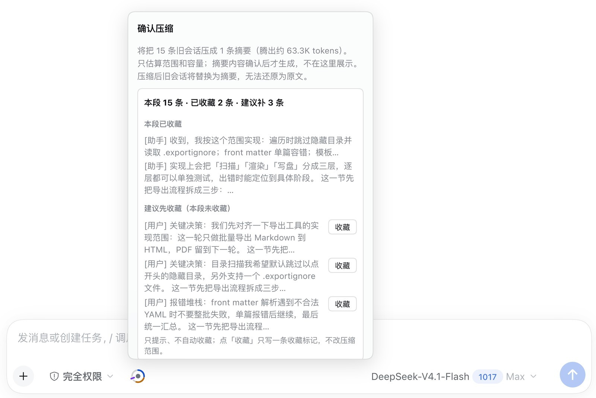
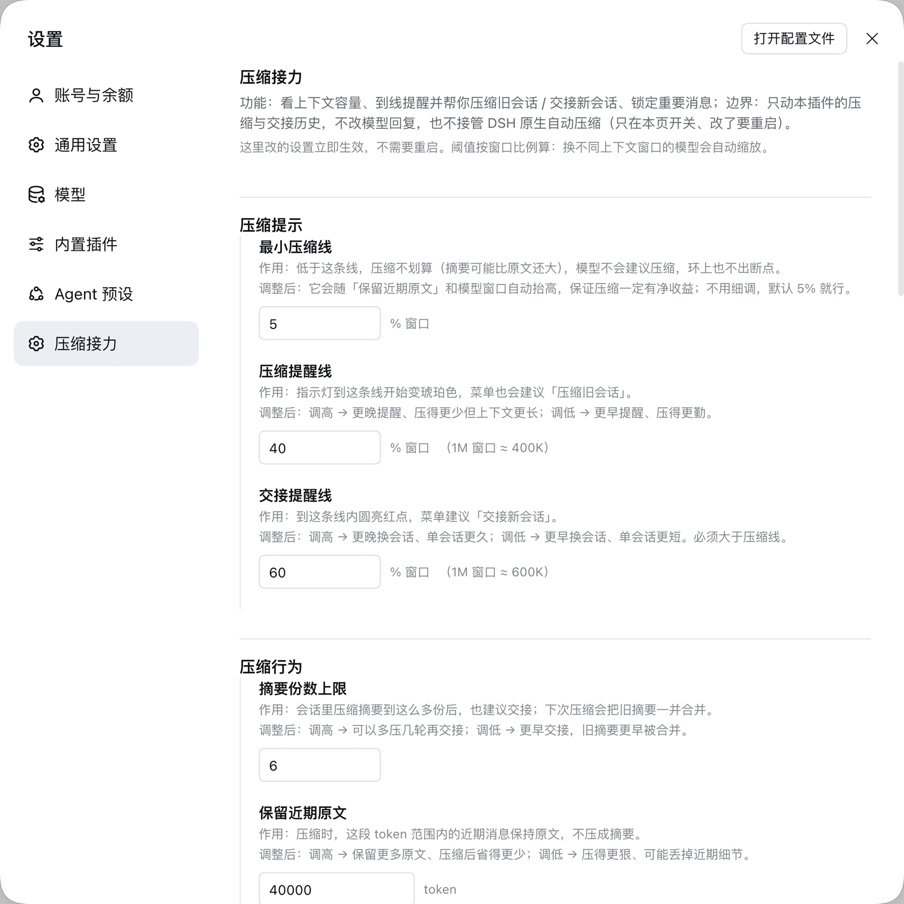
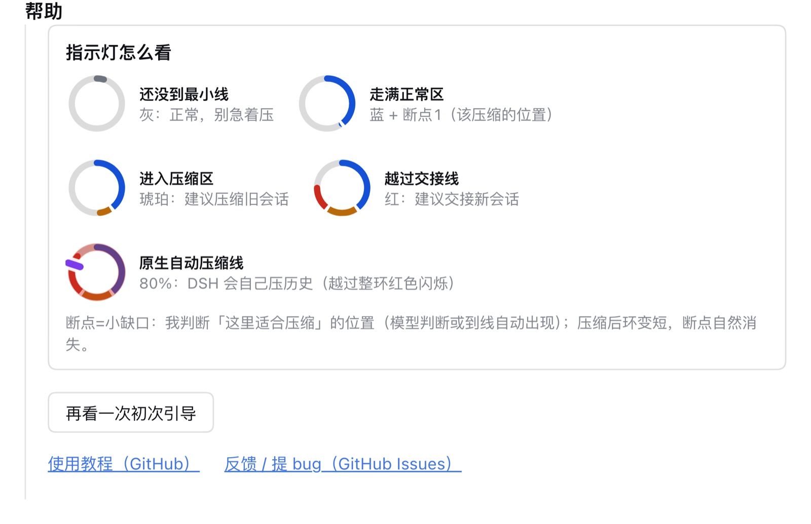
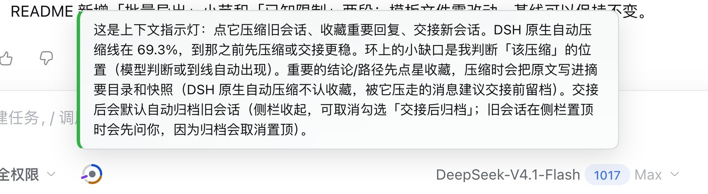

<div align="center">

# dsh-compact-relay · 压缩接力

**DeepSeek Harness 输入框上下文状态指示与会话管理插件。**

简体中文 · [English](README.en.md)

[](https://www.npmjs.com/package/dsh-compact-relay)
[](https://www.deepseek.com/harness/)
[](LICENSE)
[](CHANGELOG.md)
[](https://hub.xerj.org/contributors/cfanzx)

收录于 [XERJ Corpus Hub](https://hub.xerj.org/corpus/cfanzx--dsh-compact-relay) · 钉住 commit `435601b` · MIT · 带署名

</div>


## 概述

本插件在输入框旁提供一个 28px 的环形状态指示器，用于实时展示上下文窗口占用率与压缩评估状态，帮助用户在触发自动压缩前主动管理上下文：

- **灰色**：低于最小压缩阈值，暂无需执行压缩。
- **蓝色**：常规容量区间已满，可执行手动压缩以释放空间。
- **琥珀色（带缺口）**：达到建议压缩点（由缺口标识），点击可预览压缩估算数据并决定是否执行。
- **红色**：达到交接阈值，建议生成九段式交接文档并切换至新会话。

容量管理之外，插件还负责两件事：到线前用交接单换一个新会话接着聊；把值得回看的回复收藏起来，压缩时连同原文落档。

插件直接挂载于现有输入框旁，默认参数已针对 DSH 0.2.x 完成适配，无需改变既有操作流程。

## 核心功能

### 1. 状态可视化监控

指示环按压缩评估逻辑分段显色，只表达容量：模型或阈值判定的建议压缩点，以及 DSH 原生自动压缩线（按宿主实际 token 预算算出的触发点：deepseek-flash 约 69.3%（窗口 1.05M），配置阈值默认 80%）。0.5.1 起环上不再画消息位置，位置标记归 0.6 时间线。当上下文占用越过原生自动压缩线时，整环呈红色闪烁告警。交接提醒线晚于当前模型的实际触发线（−5pp）时，环上交接刻度旁会出现红色小警示，悬停卡与 `/handoff` 菜单也会同步标出「交接线已晚」。

上下文进入「可压缩区间」（最小压缩线到压缩线之间）时，插件会在系统提示里主动告诉模型当前容量与区间，模型据此判断「刚完成一个自然节点」时是否记录压缩节点（0.3.4 起；此前模型看不到容量，判断条件不可执行）。

鼠标悬停可查看详细数值：已用容量、累计压缩次数、当前操作建议、压缩判断点及原生自动压缩线。

### 2. 预览与确认压缩

执行 `/bc` 命令（或通过指示环菜单触发）可预先查看待压缩范围、消息条数及预计释放的容量空间，需经用户二次确认后方才执行。确认前可随时取消，未提交前不会修改任何历史记录。

0.5.3 起确认卡会列出「本段 N 条 · 已收藏 M 条 · 建议补 K 条」，展开本段已收藏条目与「建议先收藏」的候选（每条可一键收藏）——这是压缩前最后一次补救机会。已收藏的消息在压缩时把原文写进摘要的「收藏（本段）」目录，并在 `~/.dsh/dcr-favorites/snapshots/` 留快照。



### 3. 收藏与推荐收藏

**收藏 = 给「这条以后可能想回看原话」留个预约**，不是把正文存下来：

- **两步走**：点星（或命令）只写一行标记（项目级 JSONL，按会话链根存）；**原文只在压缩时落档**——压缩后摘要里出现「收藏（本段）」目录，原文另存 `~/.dsh/dcr-favorites/snapshots/` 快照。所以「标了不压缩」= 只留一个序号，这是设计而非 bug。
- **入口**：助手消息底部星标；`/favorite mark [seq]` 可标任意已完成回复（不带 seq 标最后一条）。**不需要会话开着**：归档/关闭的会话也能按 seq 标记（0.5.3 起标记层不依赖活 agent）。
- **星标常亮（0.5.5）**：已收藏的星标常亮——动作行收起时只显示这一颗星，鼠标移上去才恢复整行按钮；选择器不依赖宿主哈希类名，触屏与不支持 CSS `:has()` 的旧浏览器回退原行为。
- **推荐收藏（半自动）**：每条助手回复落地后，小模型异步打分（0-100）；够档位的星标会**金色微亮**并带「推荐」提示。三档：宽松 60 / 标准 75 / 严格 85（默认标准），另有必亮词与屏蔽词。**只点亮、绝不自动收藏**——确认仍要你点星或 `/favorite mark`。设置页可调档位/词表，并支持「试算」（粘一段原文按当前设置跑一次真实打分，只读）。
- **压缩后再补标**：若原文还在会话日志里，标记时当场写快照；读不到会明确报错，不假装成功。（从归档会话档案里读原文归 0.6。）
- **压缩后的整理（0.5.4）**：建议候选只保留用户/助手消息，工具输出不再占名额；无正文条目的标题显示为「第 seq 条」；压缩完成后自动清空本会话的推荐建议，被压走的消息不再残留。


### 4. 结构化会话交接

执行 `/handoff` 命令可生成包含九个标准部分的交接文档（总体目标、约束条件、已完成项、当前进度、涉及文件、关键决策、已知问题、未完成项、下一步计划），并在当前工作区自动创建新会话、注入该文档并完成切换，原会话完整保留。

### 5. 接力条：交接链与双向跳转

交接之后，输入卡上方会出现一条「已接力自 历史 N：<原名>」的接力条；点开它就是一个会话导航菜单：

- **完整交接链**：点「完整交接链」才**按需**读取（不展开不发请求），一次列出整条链「历史 N：<原名>」（默认服务端只读持久化日志，祖先会话没打开也能读；老宿主回落逐级查询）。每行都能打开那一跳的交接单、点整行跳到那个会话（已归档的会先自动恢复）。最多回看 8 层，链路异常成环会自动停；某一层实在读不到时保留已读行 +「无法读取更早的链路 / 上一层会话未打开」，老宿主还会给「打开并继续」（打开那一层后自动续读），不影响菜单其他入口。
- **父 → 子**：把接力棒交出去之后，父会话侧的接力条变成「已交接给新会话」，「去新会话」一键切回这次交接出来的新会话（新会话若被归档过，也会先恢复再切）。
- **置顶确认**：交接后归档旧会话会取消它的侧栏置顶（宿主行为）。旧会话置顶时，交接预览先问一次：点「交接并归档（取消置顶）」才归档，点「只交接，保留置顶」则旧会话和置顶都留着。
- **归档开关**：交接预览里可以勾掉「交接后自动归档旧会话」（默认开）；首次引导里也写了这个选项。
- **强制归档（0.5.2）**：旧会话还有任务在跑时，自动归档会「保留可见、不停止任务」。确实要清理时，接力条菜单里有「强制归档旧会话（会停止后台任务）」：点开还会再确认一次，确认面板明确写「会停止旧会话上正在跑的任务（turn / 子代理 / 后台任务 / 定时任务），中断后无法恢复」；旧会话在侧栏置顶时会补「归档会同时取消置顶（宿主行为）」。**默认不会自动做这一步**，只有你在确认面板里点「强制归档（停止任务）」才会执行。
- **宿主没加载会话也能显示（0.5.6-C）**：状态接口只认内存里的会话；宿主还没把它装进来的那一次（或会话头说有父会话、状态里却没有链），接力条会只读一次持久化日志兜底补上（不要求会话已打开），每个会话最多读一次盘；普通会话（状态明确说没有父会话）**零额外请求**。这一行为与 0.5.6-C 的真机诊断位（`<html>` 上的 `data-cr-relay-dock / chain / state`）一起，用来定位「接力条不显示」；取证步骤见 [docs/relay-bar-debug.md](docs/relay-bar-debug.md)。

> 老链（0.5.0 之前生成的会话）没有交接单路径记录，界面显示「暂无交接单」而不是猜一个——它会先向父会话只读回查一次。

## 0.5.6 新增

> 0.5.6 功能已全部合入 `fix/0.5.6` 分支；逐条说明见 CHANGELOG 的 0.5.6 小节。

- **动作事件流（本地可查）**：每个动作 start/end 两行写进 `$DSH_HOME/compact-relay-events.jsonl`（800 行上限、保底 200 条失败，写盘永不抛）；失败是它的读侧投影，不另存一份。
- **泄压阀提示（可见化）**：摘要份数到上限后，压缩会把旧摘要一起合并（不可逆）。到上限前最后一次常规压缩起，悬停卡、菜单头、压缩项 note 三处提前提示「之后每次都会合并」；确认卡里另有一块醒目警示（停止不了、只能先交接或继续）。
- **失败诊断可复制**：压缩/交接失败时，返回里带 `failureId` 与脱敏后的 `failure` 块，toast 上出现「复制诊断」——一键复制失败 id、错误码、动作、trigger、耗时等，直接贴进 issue 即可，不必再翻日志。
- **`dcr-debug` 只读诊断 CLI**：`node scripts/dcr-debug.mjs events|failures|show|state|logs|export`，读 `$DSH_HOME` 下的事件流 / state 快照，或对**本机回环**的宿主发只读 GET；不写文件、不触发压缩、不读凭据。`--help` 看全部命令。
- **接力条兜底（0.5.6-C）**：宿主还没把会话装进内存时，接力条会只读一次持久化日志补链，不要求会话已打开；普通会话零额外请求。配合 `<html>` 上的 `data-cr-relay-dock / chain / state` 诊断位定位「接力条不显示」，取证步骤见 [docs/relay-bar-debug.md](docs/relay-bar-debug.md)。
- **压缩归属**：每次压缩都记下「谁发起的」——菜单 / 命令 / 交接 / DSH 原生自动 / 来源不明。压缩完成提示、悬停卡、菜单「查看上次压缩」各显示一行；注入历史的 checkpoint 摘要头也多一行
  `〔压缩归属：菜单压缩·用户｜22 条｜32.5k tokens｜未合并旧摘要｜#a1b2c3d4〕`，模型读历史时能直接看到这段是谁压的。
  **没有归属证据时一律显示「来源不明（无归属记录）」，绝不猜成原生自动压缩**；怎么读见 [TUTORIAL.md](TUTORIAL.md) 第 5 节。
  调试端点：`GET /api/compact-relay-attribution?limit=20&sessionId=…`（只读，返回最近 N 次压缩归属）。

## 指示环图例说明

| 指示环视觉元素 | 状态含义 |
| --- | --- |
| 灰色弧 | 低于最小压缩阈值，不建议压缩 |
| 蓝色弧 | 常规容量区间已满 |
| 琥珀色弧 | 已越过压缩判断点，适合执行压缩 |
| 红色弧 | 已越过交接阈值，建议切换新会话 |
| 环形缺口 | 建议压缩点（系统在可压缩区间主动提示模型判断；模型记录或到达压缩线时自动出现） |
| 紫色刻度 | DSH 原生自动压缩线：按 `min(窗口 × thresholdRatio, 窗口 − 输出预留 − headroomTokens)` 算出的**实际触发点**（deepseek-flash 约 69.3%；`thresholdRatio` 配置默认 80%，只是理论上限） |
| 整环红色闪烁 | 已越过原生自动压缩线，即将触发 DSH 原生自动压缩 |

> 0.5.1 起环只表达容量，不再标注消息位置（位置标记归 0.6 时间线）；已收藏的消息以动作行里的金色星标标示。


## 三条线（deepseek-flash 1.05M 默认）

| 线 | 默认值 | 含义 | 怎么调 |
| --- | --- | --- | --- |
| 压缩提醒线 | 40% | 到线变琥珀色，菜单建议「压缩旧会话」 | 设置 → 压缩接力 |
| 交接提醒线 | 60% | 到线内圆亮红点，菜单建议「交接新会话」 | 设置 → 压缩接力；**硬上限 = 实际触发线 −5pp**（deepseek-flash 下 64%） |
| 原生自动压缩线 | 69.3% | DSH 按 token 预算真正触发自动压缩的点（配置阈值 80% 只是理论上限，deepseek-flash 的输出预留 + DSH 余量把它压到 69.3%） | profile 里 `compaction-basic` 的 `thresholdRatio`（默认 80%） |

**交接线为什么要留 5 个百分点**：交接提醒必须早于 DSH 自己压历史，才有时间生成交接单、开新会话。所以 0.4.2 起交接线有硬上限 **实际触发线 −5pp**（取整到整数百分位；deepseek-flash 1.05M 窗口下是 64%）：超过时**拒绝保存并提示目标值**，不静默夹紧；已存的高值不会被偷偷改写，但设置页会常驻告警，并可点「按实际线重算」一键改成上限。实际触发线算不出（无会话 / 宿主没给）时不告警、不阻断，保存校验退回配置阈值防呆（与 0.4.1 一致）。

## 安装

**环境要求**：DSH 桌面版或 `dsh web` 0.2.x（已于 0.2.1-rc.2 测试通过），Node.js 22+（插件跟随 DSH 自带运行时）。若要在源码里跑测试，需要 Node **22.15+**（测试脚手架用到 `node:module.registerHooks`）。测试已在 macOS 与 Windows 11（Node 24.22）实测全部通过。

```sh
dsh plugin --profile desktop add dsh-compact-relay
```

桌面版亦可打开 **插件 → 添加插件** 输入包名安装，或直接从 GitHub 安装：

```sh
dsh plugin --profile desktop add github:cfanzx/dsh-compact-relay
```

安装完成后需重启 DSH。插件内部配置项保存后立即生效，无需重启。

## 设置项说明

配置入口位于 **设置 → 压缩接力**（DSH 0.2.1+ 位于账号菜单内）：

- **压缩提示**：配置最小压缩线、压缩提醒线与交接提醒线，控制告警触发时机。
- **推荐收藏**：推荐开关、三档阈值（宽松 60 / 标准 75 / 严格 85）、必亮词、屏蔽词，以及「试算」（粘一段原文，按当前设置跑一次真实打分，只读）。
- **压缩行为**：配置摘要保留份数上限、近期原文保留 Token 数及交接文档存储目录。
- **DSH 原生自动压缩**：读取宿主阈值并换算实际触发线，支持开启或关闭 DSH 原生自动压缩（修改 profile 配置前自动生成备份，重启后生效）。
- **颜色与外观**：配置各项基准色（含收藏星标点亮色），系统将根据浅色/深色主题自动派生适配色阶。
- **帮助**：提供指示环图例、使用说明、问题反馈入口、「再看一次初次引导」按钮，以及「诊断信息」（只在本机生成、可预览/复制，见下节）。
- **关于与危险操作**：查看版本号、配置文件路径，支持恢复出厂默认设置。



每项配置均附带功能定义与参数修改影响说明；帮助区内置五个动态示例环图例，随当前配色与阈值实时更新。



首次打开会话时，指示环将触发动态高亮与简要功能说明（仅自动触发一次，可通过设置页按钮重新调用）。



## 诊断信息与隐私

设置 → 压缩接力 → **帮助** →「诊断信息」：

- 点【生成并预览】：**只在本机**生成一份 Markdown + JSON 诊断信息，先弹层预览；再点【复制 Markdown】/【复制 JSON】复制，自己决定粘贴到哪（例如 GitHub issue）。
- 点【打开问题报告页】：打开预填了版本/平台短字段的 GitHub issue 页，**不会**把诊断信息直接贴进去——是否粘贴、粘贴什么由你决定。

**诊断包里有什么**：插件版本、DSH 版本（拿不到就留空）、Node / 操作系统 / 架构 / 语言环境；配置的阈值、保留量、超时与颜色模式；当前状态的数值摘要（窗口、已用、摘要数、锁定数等）；本次加载后的压缩/交接/锁定计数、耗时 p50/p95，以及最近 20 条错误码。

**绝不包含**：聊天内容、摘要、交接单正文、工具参数/结果、文件路径、用户名、hostname、会话 id、密钥/token/cookie、其他插件清单或自定义链接。产物在宿主进程内按白名单逐字段构造，并额外做一遍正则脱敏（命中只替换为 `[REDACTED]`、只记数量，不保留原文）。

**三条隐私说明**：

1. 诊断信息**只在本机生成**：插件没有任何自动上传、遥测或外发网络请求；诊断端点只提供只读 GET，没有上传通道。
2. **不碰对话内容**：只采集数值、枚举、布尔与错误码，不读取消息、摘要或交接单正文。
3. 打开 issue 页只是打开浏览器；issue 默认公开，是否粘贴、粘贴到哪由你决定。插件不加网络能力，也不会上报任何数据。

## 命令列表

| 命令 | 功能说明 |
| --- | --- |
| `/bc` | 预览压缩：显示目标范围、消息条数及预计释放容量 |
| `/bc confirm` | 执行已预览的压缩操作 |
| `/handoff` | 生成九段式交接文档并创建、切换至新会话 |
| `/favorite` / `/favorite list` | 当前会话收藏目录（编号 + 角色 + 标题） |
| `/favorite mark [seq]` | 收藏一条（不带 seq 标最后一条已完成回复；不需要会话开着） |
| `/favorite last` | 收藏我刚发出的那条消息 |
| `/favorite <序号> [read]` | 报体积，或输出收藏原文 |
| `/favorite rm <序号>` / `/favorite suggest` | 取消收藏 / 列出推荐收藏建议 |
| `/pin` / `/unpin` | 0.5.3 起退役为收藏：旧命令保留兼容，锁定不再影响压缩选段与范围 |
| `/bctest` | 小范围空跑测试（仅供开发调试） |

## 功能边界与限制

- **不替代 DSH 原生压缩机制**：原生压缩仍由 DSH 宿主控制；本插件仅负责读取阈值、显示告警并在设置页提供开关选项。
- **不篡改提示词与模型回复**：插件仅在用户明确确认压缩或执行交接时替换对应历史记录。
- **摘要质量取决于底层模型**：摘要生成采用九段式结构化模板并包含格式校验与单次重试机制，但最终产出质量仍受限于所选模型的能力。
- **纯本地存储**：插件状态保存于 `~/.dsh/compact-relay.json`，交接文档保存于 `~/.dsh/handoffs/`，收藏标记与快照保存于 `~/.dsh/dcr-favorites/`，无任何外部数据同步。
- **收藏只在本插件主动压缩时落档**：DSH 原生自动压缩不认收藏，被它压走的消息不会再补写原文——重要结论建议在原生压缩线之前交接或手动压缩。标记本身只留一个序号，不复制正文、不占上下文预算。
- **依附桌面输入框**：环形指示器、`/bc`、`/handoff`、收藏星标依附 DSH 的输入框与斜杠命令；headless 会话或 QQ / 微信等桥接链路不会加载它们，在这些链路里发 `/bc` 会被当成普通消息——这是桥接链路的能力边界，不是插件故障。
- **界面语言限制**：当前版本用户界面仅提供简体中文，英文界面已列入后续计划（排期未定）。
- **模型判断提示的前置**：可压缩区间的动态提示依赖 DSH 0.2.x 的根服务 `systemPrompt`（与 memory 等插件同款）；它是启发式提示，不保证模型每次都会记录压缩节点，但条件从「不可判断」变成「可判断」。
- **旧锁定保留兼容**：0.5.3 前的 `/pin` 仍可用，但只影响交接单里的「保留契约」记录，不再参与压缩选段；界面上被外部压缩带走的旧锁定仍会标「已失效」。
- **接力链只认单亲血缘**：链记录只有 `parentId`/`childId`，「分叉 → 各走一条链 → 再合并」**没有定义**（fork 出来的副本与 subagent 会话不参与接力链，按各自独立处理）。「去新会话」只指向**最近一次**交接出来的会话（同一会话交接过两次时，更早的那个下一代请从侧栏找）。0.5.0 之前的老链由会话头 + 标题兜底合成，**没有交接单路径**，界面显示「暂无交接单」（不伪造、不猜）。
- **归档与置顶互斥**：宿主归档会话时会同时取消置顶。插件在**自动**归档前置顶会话会先问（见上），但你在侧栏手动归档置顶会话时，那一步的确认归宿主。
- **交接单的程序段随现场变化**：有旧锁定消息时，「当前进度」程序段会列出锁定条数与锚点摘要，所以不同锁定状态下重新生成交接单，**程序段内容会变**（这是有意的：交接单要反映交接那一刻的事实）。
- **完整交接链是按需读取**：展开才查（默认一次 `/api/compact-relay-chain` 由服务端只读持久化 header/日志，最多 8 层；祖先未加载也能读；不展开零额外请求）。老宿主没有该端点时回落逐级 state 查询；某层未加载会显示「上一层会话未打开」+「打开并继续」。归档会话的记录能读，但**跳转前会先恢复**（否则会被宿主拒绝）。

## 版本状态与开源许可

- **当前版本**：**0.5.6**（0.5.5 的功能版）。版本线：0.3.1 首个公开版本；0.3.2 修设置页链接与联系方式；0.3.3 Windows 适配；0.3.4 修判断机制并补交接单渲染；0.3.5 修无活 agent 时压缩按钮误禁；0.3.6 修原生压缩线解析作用域（BUG-012）；**0.4.0** 判断机制加强（cue 文案 v2 + 注入门控 + 计量）、诊断包、压缩预览建议锁定、pin 保留契约、轻账本累计、交接预览两段可编辑、接力链元数据、原生自动压缩真实触发线；**0.4.1** 统一原生压缩线显示口径；**0.4.2** 交接线保命补丁（硬上限 = 实际触发线 −5pp、三处告警 + 一键重算）；**0.5.0** 无痕交接（命名反转「历史 N」+ 新会话继承原名、输入框上方接力条、交接后自动归档旧会话 + 恢复入口）；**0.5.1** 收尾（祖先会话交接后接力条消失、0.5.0 前老链无条、归档入口死路与文案；pin 失效标注、原生压缩提前保护、置顶确认、归档开关、完整交接链、父→子入口；完整链在祖先未加载时只显示 1 层——改为服务端只读持久化日志一次读全，老宿主保留「打开并继续」兜底；设计定稿环只表达容量，pin 位置标记归 0.6 时间线）；**0.5.2** 契约快照 golden、record 形状唯一构造器、强制归档旧会话入口 + 二次确认/置顶确认、摘要缓存对齐（对话模型沿用主循环推理档位，生产命中 2–5% → 99.7%）；**0.5.3** 收藏（pin 退役；标记/落档两步解耦、无活会话可标、压缩后补标写快照）、推荐收藏（模型打分 + 三档阈值 + 必亮/屏蔽词 + 设置页试算；只点亮不自动收藏）、压缩预览卡补收藏区、P2 语义修正（already 顺序、错误码 404/503/500、归档响应瘦身、防漏杀加固）；**0.5.4** 0.5.3 debug：建议候选过滤工具角色、无正文条目标题兜底「第 N 条」、压缩后清理推荐建议投影；**0.5.5** 0.5.4 debug：已收藏星标常亮（CSS `:has()`，不依赖宿主哈希类名，hover 时其它动作照常出现）；**0.5.6** 能查案（动作事件流、500 恒带 code/failureId、toast 复制诊断、只读 `dcr-debug` CLI）、泄压阀可见化（合并旧摘要不再隐形）、接力条磁盘兜底与真机诊断位、压缩归属（谁发起 / 来源不明不猜）。已在 macOS（DSH 0.2.1-rc.2）与 Windows 11（Node 24.22）完成测试，仅调用 DSH 公开导出接口。变更记录详见 [CHANGELOG.md](CHANGELOG.md)，后续规划与已知限制详见 [ROADMAP.md](ROADMAP.md)，构建与发布流程详见 [DEVELOPMENT.md](https://github.com/cfanzx/dsh-compact-relay/blob/main/DEVELOPMENT.md)。
- **开源许可**：采用 [MIT](LICENSE) 许可证，欢迎通过 [GitHub Issues](https://github.com/cfanzx/dsh-compact-relay/issues) 与 Pull Requests 提交反馈。

## 参考与致谢

本插件的设计参考了以下 DSH 社区插件与项目的公开实现（仅借鉴思路，未复制代码）：

- [DeepSeek Harness](https://www.deepseek.com/harness/) — 插件运行的宿主平台；本插件的全部宿主能力均来自其公开导出接口。
- [dsh-clear-mind](https://github.com/john-walks-slow/dsh-clear-mind) (MIT) — 自建替换事务与边界/锁检查的写法参照。
- [dsh-handoff-compaction](https://github.com/knighthongyu/dsh-handoff-compaction) (MIT) — 摘要结构校验、重试与缓存对齐。
- [dsh-compaction-policy](https://github.com/zyd232/dsh-compaction-policy) (MIT) — preset 作用域引擎的运行时门控思路。
- [context-vista](https://github.com/GooodWei/context-vista) (MIT) — 环形图绘制与 session projections 实时订阅。
- [dsh-session-handoff](https://github.com/WeiYe6/dsh-session-handoff) (MIT) — `/handoff` 建会话与自动切换流程。
- [dsh-smart-compact](https://github.com/hoyyang/dsh-smart-compact) (BSD-3-Clause) — 预算测量与交接锚点设计。
- [dsh-toolong-warning](https://github.com/Hjdd14/dsh-toolong-warning) (MIT) — 压缩计数与提醒。
- [dsh-compaction-instant](https://github.com/TsFreddie/dsh-compaction-instant) (MIT) — 事务错误分类契约。
- [dsh-plugin-memory](https://github.com/LittleBlackTong/dsh-plugin-memory) — 设置栏在 DSH 中的注册与渲染方式参考。
- [awesome-dsh-plugin](https://github.com/awesome-dsh-plugin/awesome-dsh-plugin) / [dsh-market](https://github.com/dsh-market/dsh-market) — 社区插件目录与可视化市场。

感谢以上作者公开实现；也感谢所有帮忙测试、提反馈的朋友。

## 联系方式

- **官方渠道**：GitHub 仓库 <https://github.com/cfanzx/dsh-compact-relay> 与 [Issues](https://github.com/cfanzx/dsh-compact-relay/issues)（问题反馈、功能建议、发布公告）。
- **开发者邮箱**：cfanzx@136.com（合作、安全问题，以及其他不便公开讨论的事项）。
